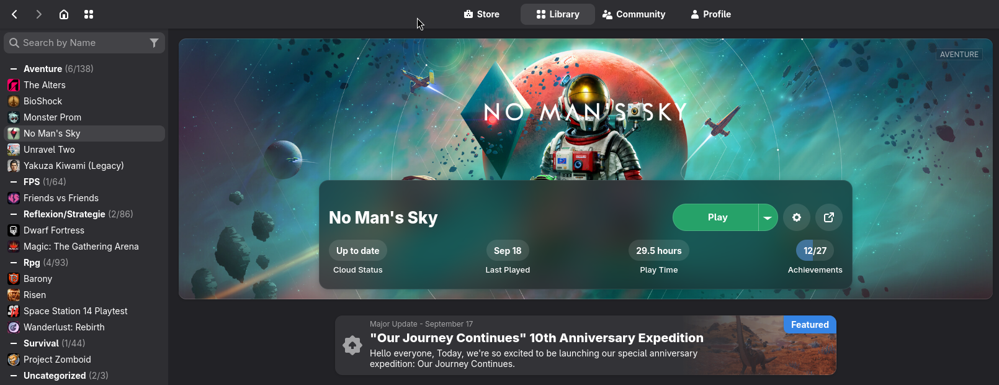
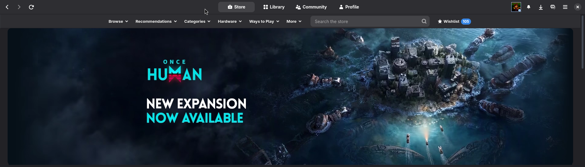
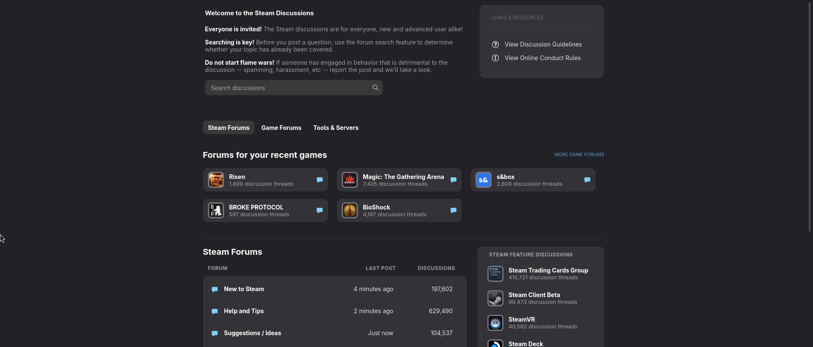

<div align="center">

# Adw Lite

**Steam aux couleurs de GNOME / libadwaita — client *et* pages web.**

Un thème [Millennium](https://steambrew.app) qui applique le design system Adwaita
à toute l'application : bibliothèque, amis, réglages, dialogues, mais aussi le
magasin, la communauté, le marché, l'inventaire, le Workshop et les forums.

[](https://steambrew.app)
[](https://gnome.pages.gitlab.gnome.org/libadwaita/)
[](LICENSE)
[](skin.json)



</div>

## Aperçu

| Magasin | Discussions |
|:-:|:-:|
|  |  |

## Points forts

- 🎨 **Adwaita partout** : couleurs, rayons, boutons, champs, onglets, cartes, spinner
  et flèches de carrousel de libadwaita, dans le client comme sur les pages web.
- 🌗 **Clair, sombre ou système**, palette GNOME 48+ ou gris neutres, et les
  **9 couleurs d'accent** de GNOME qui remplacent le bleu Steam partout.
- 🧩 **Composants uniques et réutilisables** : un seul bouton, une seule carte, une
  seule pagination, un seul pouce « recommandé »… déclinés par variables CSS.
- 🖼️ **Avatars carrés** avec leurs cadres de profil, fonds de profil personnalisés
  conservés et rendus lisibles.
- 📚 **Bibliothèque repensée** : grande illustration arrondie, panneau translucide
  avec le bouton Jouer, barre compacte qui reste visible au défilement.
- ⚡ **Rapide** : aucun `:has()` dans la fenêtre principale (converti à la
  compilation), polices système, pas de police ni d'image téléchargée.
  La page d'un jeu se stabilise en ~0,6 s, contre ~3,8 s avec la feuille d'origine.

## Installation

### 1. Installer Millennium

Le thème a besoin de **[Millennium](https://steambrew.app)**, le gestionnaire de
thèmes et de plugins pour Steam. Suivez les instructions d'installation de son
site pour votre système (Windows ou Linux), puis lancez Steam une fois.

### 2. Ajouter le thème

**Avec Git (recommandé, mises à jour faciles)**

Clonez le dépôt dans le dossier des thèmes de Millennium :

```sh
# Linux
cd ~/.local/share/Steam/millennium/themes
git clone https://github.com/leoyd/steam-gnome-adwaita-millenium-theme.git
```

```powershell
# Windows (PowerShell)
cd "C:\Program Files (x86)\Steam\millennium\themes"
git clone https://github.com/leoyd/steam-gnome-adwaita-millenium-theme.git
```

**Sans Git**

1. Téléchargez l'archive : **Code → Download ZIP** sur cette page.
2. Décompressez-la dans le dossier `millennium/themes` de votre dossier Steam.

> [!NOTE]
> Le dossier des thèmes se trouve dans le dossier d'installation de Steam :
> `millennium/themes`. Sur Linux, c'est en général
> `~/.local/share/Steam/millennium/themes` (ou `~/.steam/steam/millennium/themes`).
> Les fichiers compilés sont inclus : il n'y a rien à construire.

### 3. Activer le thème

1. Ouvrez Steam, puis le menu **Millennium** (menu ☰ en haut à droite → *Millennium*).
2. Dans **Thèmes**, choisissez **Adw Lite**.
3. Redémarrez Steam quand Millennium le propose.

### Mettre à jour

```sh
cd ~/.local/share/Steam/millennium/themes/steam-gnome-adwaita-millenium-theme
git pull
```

Puis redémarrez Steam (les pages web se mettent à jour dès la navigation
suivante, le client au redémarrage).

## Options

Toutes les options se règlent dans **Millennium → Thèmes → Adw Lite**.

| Option | Choix (défaut en gras) |
|---|---|
| Mode de couleur | **Sombre**, Clair, Système |
| Palette | **GNOME 48+**, Gris neutre (avant GNOME 48) |
| Couleur d'accent | **Bleu**, Turquoise, Vert, Jaune, Orange, Rouge, Rose, Violet, Ardoise |
| Boutons de fenêtre | **GNOME (fermer)**, Réduire / agrandir / fermer, À gauche (macOS), Pantheon |
| Étagère Nouveautés | **Afficher**, Masquer |
| Liste des jeux | **Toujours visible**, Au survol |
| Icônes carrées | **Oui**, Non |
| Listes limitées à 6 | **Oui** (amis, activité, contenu de la communauté par 6 + « Voir plus »), Non |
| Illustrations de fond | **Masquées**, Affichées (fonds des fiches de jeu ; les fonds de profil restent affichés) |
| Adresse des pages | **Masquée**, Affichée |
| Mini-bandes-annonces | **Désactivées** (non téléchargées : plus léger), Activées |
| QR code de connexion | **Afficher**, Au survol, Masquer |

## Conseils de performance

- Laissez **Mini-bandes-annonces** sur *Désactivées* et **Listes limitées à 6** sur *Oui* :
  moins de vidéos et d'éléments à charger dans le magasin et la bibliothèque.
- Dans **Steam → Paramètres → Bibliothèque**, le *mode faible bande passante* et le
  *mode performances réduites* allègent encore l'affichage.

## Limites connues

- Les menus déroulants restent rectangulaires : sur certains systèmes (Linux /
  Wayland), les fenêtres de menu de Steam ne sont pas transparentes, et des coins
  arrondis y apparaîtraient en noir. Les éléments des menus, eux, sont arrondis.
- Steam change parfois ses noms de classes lors de ses mises à jour : un élément
  peut alors perdre son style jusqu'à la mise à jour du thème.

## Développement

Le thème est écrit en CSS modulaire dans `src/` puis assemblé et minifié par
`build.py` :

```sh
npm install        # une fois : outils de conversion des :has()
python3 build.py   # régénère millennium/*.css, millennium/has.js et webkit/webkit.min.css
```

Architecture, composants, performances et maintenance après une mise à jour de
Steam : voir **[docs/DEVELOPMENT.md](docs/DEVELOPMENT.md)**.

## Crédits

- [Adwaita-for-Steam](https://github.com/tkashkin/Adwaita-for-Steam) de **tkashkin**
  — base du thème client (MIT).
- [libadwaita](https://gnome.pages.gitlab.gnome.org/libadwaita/) et le
  [GNOME Human Interface Guidelines](https://developer.gnome.org/hig/) — design system.
- [Millennium](https://steambrew.app) — chargement des thèmes dans Steam.

## Licence

[MIT](LICENSE). Ce thème n'est affilié ni à Valve, ni au projet GNOME.
